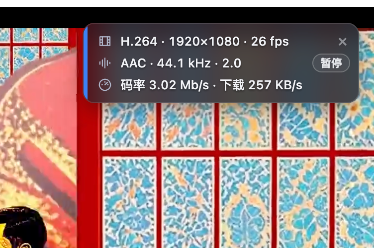
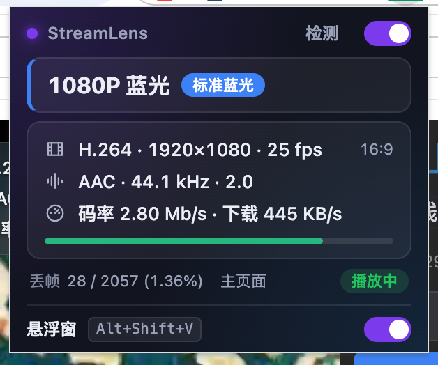

# StreamLens

网页视频画质检测浏览器插件。播放视频时，在画面右上角实时显示视频的真实参数，一眼看出是不是“假高清”。

<!-- 在这里放截图：悬浮窗效果、弹窗效果 -->



## 功能

- **悬浮窗**：显示在视频右上角，三行信息，左侧色条表示画质（绿：高码率，蓝：标准，红：码率偏低）。

  ```
  H.264 · 1920×1080 · 25.4 fps
  AAC · 48 kHz · 2.0
  码率 712 kb/s · 下载 753 KB/s
  ```

- **画质评级**：按分辨率和码率判断，码率过低的会标出 `⚠ 疑似假1080P`。
- **工具栏角标**：显示当前视频的分辨率档位（如 `1080`、`4K`）。
- **详情弹窗**：点击插件图标，查看评级、丢帧统计、视频来源和播放状态。
- **快捷键**：`Alt+Shift+V` 显示或隐藏悬浮窗。
- **不收集数据**：不联网，不上传任何信息。

## 安装

1. 在右侧 **Releases** 下载最新的 `stream-lens-x.y.z.zip`，解压（解压后不要删除或移动这个文件夹）。
2. 浏览器打开 `chrome://extensions`，打开右上角 **开发者模式**。
3. 点 **加载已解压的扩展程序**，选择解压后的文件夹。
4. 刷新已打开的视频网页。

支持 Chrome 111 及以上，以及 Edge、Brave 等 Chromium 内核浏览器。

## 说明

- 音频信息和下载速度只在 YouTube、B站这类流媒体网站上有，直链 MP4 没有。
- 码率是估算值，不等于视频标称码率。
- Canvas 渲染的播放器和 DRM 内容检测不到或不完整。

## 开发

```
node tools/validate.js
node --test 'tests/*.test.js'
```
